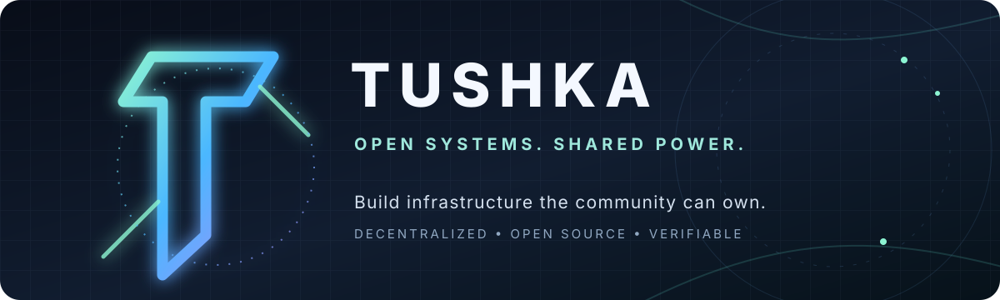

  

  <strong>INDEPENDENT BY DESIGN · OPEN BY DEFAULT · POWER DISTRIBUTED</strong>

  <a href="#the-mandate">THE MANDATE</a> ·
  <a href="#operating-doctrine">DOCTRINE</a> ·
  <a href="#the-work">THE WORK</a> ·
  <a href="#current-build-status">BUILD STATUS</a> ·
  <a href="#join-the-build">JOIN THE BUILD</a>

---

## The mandate

**Tushka exists to increase the agency of the people who build, maintain, and depend on open technology.**

The objective is not visibility for its own sake. It is durable capability: tools people can inspect, systems they can fork, knowledge they can verify, and infrastructure no single gatekeeper needs to own.

Power should come from what is built, what is shared, and what continues to work when its original creator steps away.

> **Do not ask the community to trust the machine. Make the machine inspectable. Give the community the means to change it.**

## Operating doctrine

<table>
  <tr>
    <td width="50%" valign="top">
      <h3>01 / Sovereignty</h3>
      Favor user control, portability, self-hosting, and exit paths. Avoid needless lock-in.
    </td>
    <td width="50%" valign="top">
      <h3>02 / Verifiability</h3>
      Claims need evidence. Designs need rationale. Releases need reproducible instructions.
    </td>
  </tr>
  <tr>
    <td width="50%" valign="top">
      <h3>03 / Composability</h3>
      Build small pieces with clear interfaces. Prefer interoperable systems over isolated empires.
    </td>
    <td width="50%" valign="top">
      <h3>04 / Shared capability</h3>
      Document the hard parts. Make contribution paths clear. Leave maintainers stronger.
    </td>
  </tr>
  <tr>
    <td width="50%" valign="top">
      <h3>05 / Security as a foundation</h3>
      Minimize trust, permissions, dependencies, and exposed data. Treat threat models as design inputs.
    </td>
    <td width="50%" valign="top">
      <h3>06 / Durable impact</h3>
      Optimize for usefulness, maintainability, and adoption—not noise, vanity metrics, or hype.
    </td>
  </tr>
</table>
## The work

The public portfolio is at an early foundation stage. These are the real, currently available destinations—no placeholder projects or invented activity.

<table>
  <tr>
    <td width="58%" valign="top">
      <h3><a href="https://github.com/TushkaLoLz31337">Tushka / GitHub</a></h3>
      The public home for releases, experiments, documentation, and community-facing work.
        
      <a href="https://github.com/TushkaLoLz31337?tab=repositories">Browse public repositories →</a>
    </td>
    <td valign="top">
      <h3><a href="https://github.com/TushkaLoLz31337/tushka-master">Tushka Master</a></h3>
      Private strategy and operations workspace. Visible only to authorized collaborators.
    </td>
  </tr>
  <tr>
    <td valign="top">
      <h3><a href="https://github.com/TushkaLoLz31337/TushkaLoLz31337">This profile repository</a></h3>
      Public identity, contribution entry points, and profile documentation.
        
      <a href="https://github.com/TushkaLoLz31337/TushkaLoLz31337/commits/main/">Inspect the change history →</a>
    </td>
    <td valign="top">
      <h3><a href="https://github.com/TushkaLoLz31337/TushkaLoLz31337/issues">Public issue tracker</a></h3>
      Propose an initiative, report a problem with this profile repository, or help improve its community workflows.
    </td>
  </tr>
</table>

## Current build status

| Project / capability | Status | Next milestone |
|---|---|---|
| [Tushka Swarm Collective](https://github.com/TushkaLoLz31337/tushka-swarm-collective) | Alpha — `v0.1.0-alpha` published | Reviewed integration and release-quality gates |
| Agent coordinator and deterministic demo | Implemented | Verified bounded local task dispatch |
| Local-model adapter (Ollama-compatible endpoint) | Implemented; experimental | Integrate and test the broker workflow |
| Security and release controls | In progress; owner settings remain a blocker | Enable dependency graph/security settings and protect `main` |
| Stage 1 collaboration milestone | In progress | Local agent collaboration, independent verification, and resumable checkpoints |

**Current focus:** Stabilize this account's flagship build. Five pull requests are being reviewed; no new project expansion is underway. Planned federation, persistent shared knowledge, remote execution, and production deployment are not claimed as implemented.

## What earns attention here

- **Useful over ornamental.** A tool should solve a real problem or teach something worth reusing.
- **Open over performative.** Publish source, decisions, limitations, and maintenance expectations where appropriate.
- **Interoperable over captive.** Favor open formats, documented interfaces, and portable workflows.
- **Measured over marketed.** Report what works, what does not, and what remains unproven.
- **Community over personality cult.** The work should be forkable, challengeable, and able to outlive its author.

## The Huffman ecosystem public build

Tushka is beginning a public, evidence-led build with the Huffman ecosystem as its first participating network of contributor accounts. Each account will submit a dated snapshot of its public open-source work. The goal is to map useful capabilities, preserve provenance, identify reusable components, and establish concrete build jobs—not to mass-fork repositories or claim ownership of upstream work.

**Start here:**
- [Huffman ecosystem build outline](./HUFFMAN-ECOSYSTEM.md) — contributor roles, operating principles, and the public build scope.
- [Public material deposit guide](./DEPOSIT-GUIDE.md) — onboarding, snapshot requirements, provenance, and intake review.
- [Build roadmap and checkpoints](./BUILD-ROADMAP.md) — jobs, acceptance evidence, preservation, and expansion gates.
- [Submit a public material deposit](../../issues/new?template=public-material-deposit.yml) — one account snapshot per request.

The founding account roles are provisional. Demonstrated skills will be published only after reviewing repository evidence submitted by each account. Unknowns will remain explicitly marked as pending.

## Don't just fork it. Make it better. Send it upstream.

Open source works best when improvements travel. Find a project worth building upon. Fork it when the license and project rules allow. Explore it, fix something, improve the documentation, add tests, or make it more accessible. Verify the work, then offer it back to the original maintainers.

**Discover → Fork → Improve → Verify → Submit upstream → Share**

A fork is a contribution station, not a claim over the upstream project. The original maintainers decide whether a pull request is accepted. If work remains independent, document its divergence, attribution, license, and maintenance plan honestly.

- [Read the upstream contribution guide](./UPSTREAM-CONTRIBUTION-GUIDE.md)
- [Open an upstream contribution record](../../issues/new?template=upstream-contribution.yml)

We are not here to collect forks. We are here to make open-source work more useful, more connected, and more durable.

## Join the build

Open source is not an audience. It is a network of people making each other's work more capable.

- **Have a concrete proposal?** [Open an initiative](https://github.com/TushkaLoLz31337/TushkaLoLz31337/issues/new?template=initiative.yml).
- **Found a problem in this profile repository?** [Report an issue](https://github.com/TushkaLoLz31337/TushkaLoLz31337/issues/new).
- **Want to contribute?** Read the [contribution guide](./CONTRIBUTING.md) before opening a pull request.
- **Want to inspect the source?** [Browse this repository](https://github.com/TushkaLoLz31337/TushkaLoLz31337).

### What makes a strong proposal?

A clear problem, who it affects, why existing options fall short, a plausible approach, and how success could be verified. Small, testable steps beat grand claims.

---

  <strong>NO GATEKEEPERS BY DEFAULT. NO CLAIMS WITHOUT EVIDENCE. NO POWER WITHOUT ACCOUNTABILITY.</strong>
   
  TUSHKA · Build what others can own.

